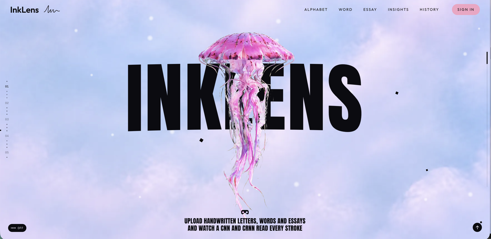
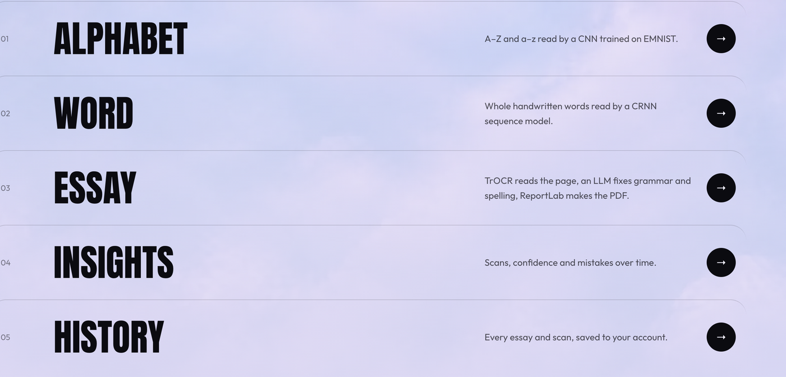
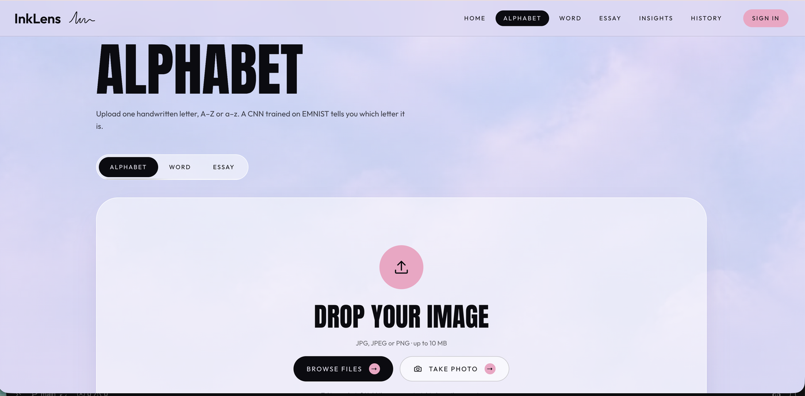
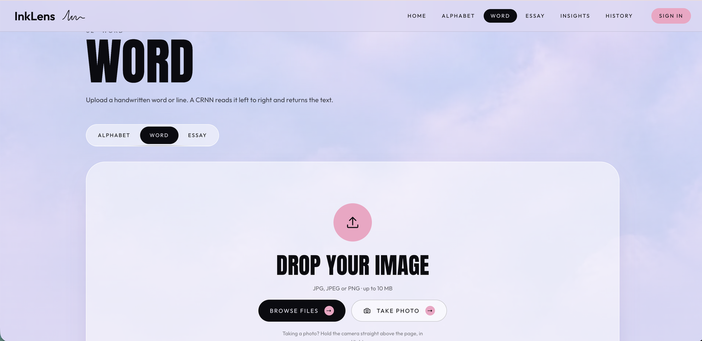
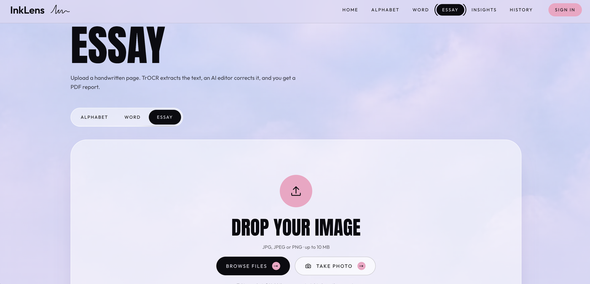

# 🪼 InkLens: Handwritten Character Recognition

My submission for **CodeAlpha Machine Learning Internship, Task 3: Handwritten Character Recognition**. InkLens reads handwritten letters, digits, words and whole essays from a photo, and can correct and score an essay.



## ✨ Features
- 🔤 **Alphabet and digit recognition**: a CNN trained on EMNIST (62 classes) with Auto, Upper, Lower and Digit modes. For letters whose upper and lower case look the same (c/C, o/O, s/S, v/V, w/W, x/X, z/Z) it says "case unclear" instead of guessing
- 📝 **Words and notes**: a TrOCR transformer reads a word, a chit or a page of handwriting line by line and returns text you can edit, copy or download
- 📄 **Essay correction**: a photo of a handwritten essay is read, then an AI editor fixes grammar and spelling and returns feedback and scores, plus a downloadable **PDF report**
- 📷 Upload JPG, JPEG or PNG (up to 10 MB), or take a photo with the camera
- 🕘 **History** of your scans with a **Clear all** button, and an **Insights** dashboard with scans, confidence and mistakes over time
- 🔐 Optional sign-in with Supabase



| Alphabet | Word | Essay |
|---|---|---|
|  |  |  |

## 📊 Results
The letter and digit CNN was trained on the EMNIST "byclass" dataset (62 classes, 12 epochs on a Colab T4 GPU).

| Metric | Score |
|---|---|
| Test accuracy, all 62 classes | **88.1%** |
| Test accuracy, letters only | **91.3%** |

Some characters have the same shape in both cases or look alike (O and 0, l and I), so the training script also saves a confusion matrix and the most-confused pairs in `backend/models/`. Word and essay reading uses the pretrained `microsoft/trocr-small-handwritten` model.

## 🧠 How it works
```
Character:   photo → clean and centre the stroke → shown to the CNN in several thicknesses
             → predictions averaged → letter / digit + confidence

Word/essay:  photo → split into text lines → TrOCR reads each line → text
             → (essay) AI editor corrects, scores and gives feedback → PDF report
```
- **CNN:** three blocks of two conv layers with batch norm, pooling and dropout, built-in augmentation (rotation, zoom, shift), a 256-unit dense layer and a softmax over 62 classes.
- **Photo preparation:** pen strokes in photos are thinner than EMNIST letters, so the image is prepared to match, and the answers from a few variants are averaged (test-time augmentation).
- **Essay editor:** an LLM (Gemini first, Groq as a fallback) corrects and scores the text. API keys stay in `backend/.env` and are never committed.

## 🧰 Tech stack
| Layer | Technology |
|---|---|
| Frontend | React 19, Vite, Tailwind CSS v4, Recharts, React Router |
| Backend | Python, Flask, OpenCV, ReportLab, SQLite (history) |
| ML | TensorFlow / Keras CNN (EMNIST), PyTorch + Hugging Face TrOCR |
| Auth (optional) | Supabase |

## 📁 Project structure
```
CodeAlpha_HandwrittenCharacterRecognition/
├── frontend/            React app
├── backend/
│   ├── app.py           Flask API
│   ├── api/             recognize, essays, history routes
│   ├── ml/              CNN, TrOCR reader, line splitting, preprocessing, essay corrector
│   ├── training/        EMNIST training script and instructions
│   ├── models/          emnist_cnn.keras
│   └── tests/
└── docs/                screenshots
```

## 🚀 Run it locally

**Backend** (Python 3.10–3.12)
```bash
cd backend
python3 -m venv .venv && source .venv/bin/activate
pip install -r requirements.txt
cp .env.example .env        # optional: add LLM_API_KEY or GROQ_API_KEY for essay correction
python app.py
```
The letter model is `backend/models/emnist_cnn.keras`. If it is missing, train it with the steps in [`backend/training/README.md`](backend/training/README.md). TrOCR downloads (about 250 MB) the first time you read text.

**Frontend**
```bash
cd frontend
cp .env.example .env
npm install
npm run dev
```
Open `http://localhost:5173`.

## 🔌 API
| Endpoint | Input | Output |
|---|---|---|
| `POST /api/recognize/character` | `image`, optional `case` (auto, upper, lower, digit) | predicted character, confidence, preview |
| `POST /api/recognize/word` | `image` | text, confidence, per-line boxes |
| `POST /api/essays` | `image` | raw text, corrected text, scores, feedback |
| `GET /api/essays/<id>/report` | none | PDF report |
| `GET /api/history`, `DELETE /api/history` | none | list or clear your scans |
| `GET /api/analytics` | none | counts and confidence for Insights |

## ⚠️ Limitations
- Messy handwriting, very thin pens, shadows and skewed photos reduce accuracy. Clear, well-lit photos work best.
- Essay correction needs an LLM key and an internet connection. The scores are an AI opinion, not a grade.

## 🙏 Credits
EMNIST (Cohen et al.), `microsoft/trocr-small-handwritten` (Li et al.) via Hugging Face.

## 👩‍💻 Author
Built by **Shreya Mhatre** as part of the CodeAlpha Machine Learning Internship.  
GitHub: [@shreya09032006](https://github.com/shreya09032006)
